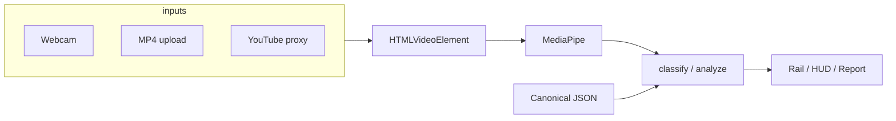

# Architecture overview

## Runtime

- **Next.js 16** static export (`GITHUB_PAGES=true` → `basePath: /stancejudge`).
- **No server** on Pages except optional **YouTube byte proxy** (Vercel `youtube-proxy/` or dev `/api/youtube`).
- All pose inference: **MediaPipe Pose Landmarker** in browser (`@mediapipe/tasks-vision`).

## Data flow

## Key modules

| Path | Role |
| --- | --- |
| `src/components/routine-judge.tsx` | Routine video session |
| `src/components/stance-judge.tsx` | Live camera session |
| `src/components/pose-rail.tsx` | Horizontal move strip |
| `src/lib/wushu/sequence.ts` | Video scan + alignment |
| `src/lib/wushu/classify.ts` | Per-frame leg/hand |
| `src/lib/pose/*` | Landmarks, draw, athletic analyze |
| `src/data/canonical/*.json` | Coach timings (committed) |
| `src/lib/admin/store.ts` | Browser overrides |

## Development rules (GitHub-only)

1. Canonical remote: `https://github.com/dnomyar84/stancejudge` — push `main` after every task.
2. Read `docs/product/features.md` before large UI changes.
3. Keep static export compatible (`npm run build:pages`).
4. No backend DB; prefer JSON + IndexedDB.
5. Mirror: CSS on video/canvas together; do not double-mirror in `drawPose`.
6. Update feature status in the same commit as implementation.
