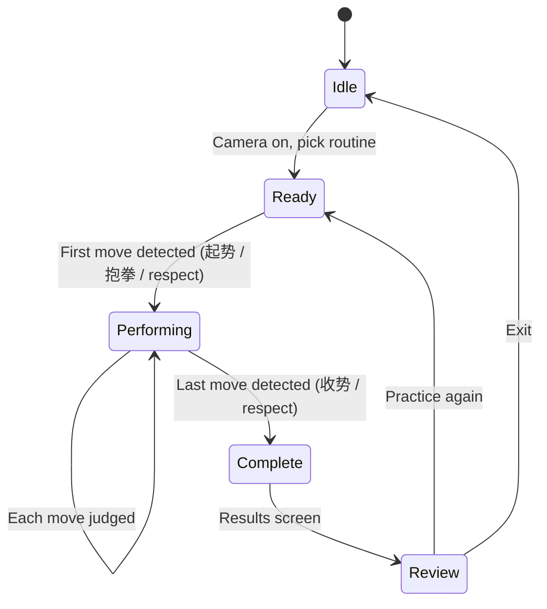

# Gameplay vision — “Wushu DDR”

Students should feel like **Dance Dance Revolution for forms**: perform in real time, see whether each beat/move was met, get **instant gratification** for good technique, and **clear penalties** for misses or shallow stances. At the end, **review your run** like a game results screen.

## Core loop (live camera — primary target)



| Phase | What the user sees |
| --- | --- |
| **Idle / Ready** | Routine selected, “Step into frame — begin when you’re ready” or “Perform 起势 to start” |
| **Performing** | Pose rail advances; **active move** highlighted; **live grade** on each window (Perfect / Good / Miss) |
| **Complete** | Brief celebration; transition to results |
| **Review** | Total score, per-move breakdown, best/worst stances, optional replay markers |

## Judgment model (per move window)

Each canonical move has a time window (live: from classification stability; video: from playback time + scan).

| Grade | Meaning | Example cues |
| --- | --- | --- |
| **Perfect** | Correct move order + stance depth + hand profile in window | Full 马步 depth, correct 剑法 |
| **Good** | Right move, minor form issues | Shallow 弓步, guard slightly low |
| **Miss** | Wrong move, wrong order, or absent | Skipped step, wrong leg |
| **Early / Late** (optional P2) | Right pose outside window | DDR-style timing |

**Stance depth** is not binary: knee angle / hip height vs thresholds for `gong_bu`, `ma_bu`, `xu_bu` → maps to Good vs Miss or “LOW” penalty tier.

## Visual feedback — reward (must feel awesome)

| Event | Visual (respect `prefers-reduced-motion`) |
| --- | --- |
| Perfect | Green flash, chip **burst**, +score floater, combo counter tick, optional particle spark on skeleton joints |
| Good | Cyan pulse, smaller +points, satisfying click sound |
| Combo ×N | Rail glow intensifies; multiplier badge (×2, ×3…) |
| Move complete | Chip locks green; short 起势-style “shine” on rail |

## Visual feedback — penalty (must be obvious)

| Event | Visual |
| --- | --- |
| Miss / wrong move | Red flash, chip shake, “MISS” / “错” floater, combo break |
| Shallow stance | Amber “LOW” meter under active chip + knee icon; points at reduced multiplier |
| Wrong weapon profile | “剑!” / hand silhouette mismatch hint |
| Out of frame | HUD dims; “Step back” — pauses scoring, does not fake Miss |

## Routine boundaries (起势 → 收势)

| Detection | Typical move | Behavior |
| --- | --- | --- |
| **Start** | First syllabus move (often 起势 / 抱拳礼 / standing respect) | Stable classification match ≥ N frames → `Performing`, timer/score starts, rail at move 0 |
| **End** | Last move (收势 / closing respect) | Match last move + stability → `Complete`, freeze live grading, show results CTA |

False starts: brief pose similar to 起势 should not start until **confidence + duration** threshold (configurable per routine in canonical JSON).

## Results screen (end of run)

- **Total score** (0–100 or letter rank S/A/B/C for kids)
- **Per-move table**: grade, leg/hand icons, depth bar, coach tip if Miss
- **Summary stats**: Perfect count, combo max, weakest stance type
- **Actions**: Practice again, share screenshot (future), watch reference link

## Video mode vs live mode

| Mode | DDR feel today | Target |
| --- | --- | --- |
| **Routine video** | Rail colors after background scan | **Also** real-time rail + floater if user plays video (synced judgment) |
| **Live camera** | Stance % only | Full rail + grades + start/end + results |

## Audio (P2)

- Perfect/Good/Miss stingers (mutable)
- Optional count-in before start
- No autoplay until user taps “Sound on” once

## What users expect (gap vs current build)

| Expectation | Backlog |
| --- | --- |
| Feels like a game while moving | F-037–F-041, F-046 |
| Know when routine started/ended | F-042, F-043, F-044 |
| See score review after | F-045 |
| Shallow stances penalized visibly | F-038 |
| Wrong move obvious | F-041 (penalty juice) |
| First/last = respect moves | Canonical flags `isRoutineStart` / `isRoutineEnd` on moves (F-042) |

## Canonical data extensions (design)

```json
{
  "id": "sdj-00",
  "nameZh": "起势",
  "routineBoundary": "start",
  "depthThresholds": { "minKneeAngleDeg": 150 }
}
```

Coach calibrates windows; agent implements readers in `classify.ts` / session FSM.
