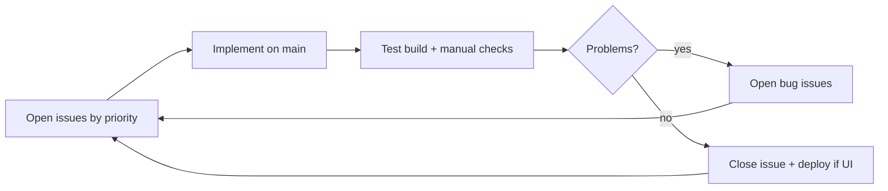

# Issues-driven iteration

## Roles (see [governance.md](./governance.md))

- **Owner** reviews design in `docs/product/` and can comment on or reprioritize **GitHub Issues**.
- **Agent** owns implementation: pick issues, fix, test, close, push `main`, deploy when needed.

## What lives where

| Artifact | Purpose |
| --- | --- |
| **`docs/product/*.md`** | Stable design intent, UX specs, feature **IDs** (F-###), acceptance criteria templates |
| **GitHub Issues** | **Execution backlog** — what to build next, bugs found in testing, open until verified fixed |
| **`docs/product/features.md`** | Catalog + ID registry; link each planned item to an issue number when created |

## Labels

| Label | Meaning |
| --- | --- |
| `type:feature` | New capability / planned F-### work |
| `type:bug` | Regression or defect from testing |
| `type:tech-debt` | T-### maintainability / infra |
| `priority:P1` … `P3` | Pick highest P with open issues first |
| `area:live` / `area:routine` / `area:admin` / `area:deploy` | Scope |

## Agent loop

1. **Triage:** `gh issue list --state open --label priority:P1`
2. **Claim:** comment `agent: working` optional; set label `status:in-progress` if used
3. **Implement** on `main`; reference issue in commit: `Fixes #12` or `F-010: …`
4. **Test:** `npm run build:pages`; smoke live + routine paths
5. **New bugs** → new issues (do not only mention in chat)
6. **Close** issue when acceptance criteria met; update `features.md` status if F-### issue

## Definition of “done” for a release slice

Not “zero issues forever” — but **no open `priority:P1` bugs** for the current milestone, and planned P1 features for the phase are **closed**.

## Creating issues

- Template: **Feature** or **Bug** under New issue
- Bugs from testing: always file, even if small
- Feature requests: prefer existing **F-###** from [features.md](./features.md)
