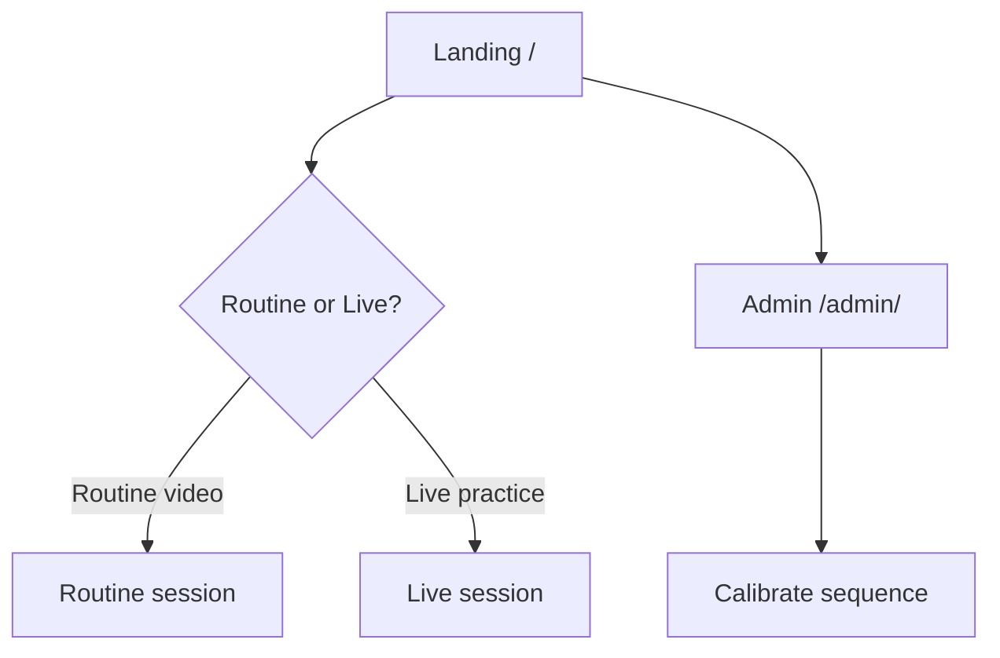
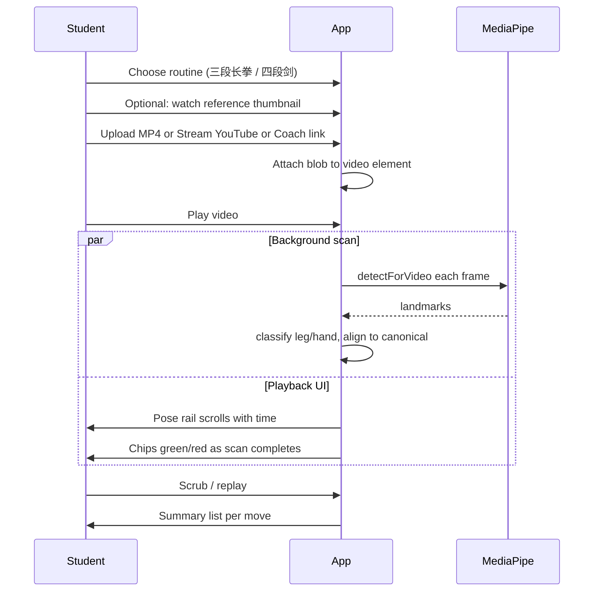
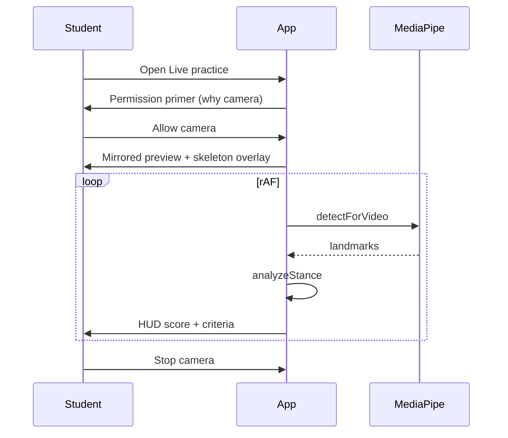

# UX flows & screen map

## Entry & navigation

**Today:** tabs on one page. **Target (F-010):** dedicated home with mode cards; tabs become in-session only or removed.

## Flow A — Routine video (student)

**Goal:** Compare student recording to calibrated sequence; pose rail shows met/missed per move.

### Required UI states (routine)

| State | UI |
| --- | --- |
| No video | Empty stage + “Upload or Stream” + Coach link |
| Loading YouTube | Progress bar + cancel |
| Video ready, not scanned | Play CTA + “Scan runs while you play” hint |
| Scanning | Rail chips amber; progress % optional |
| Scan complete | Rail green/red; move detail panel |
| Error | Inline alert + fallback (upload MP4) |

## Flow B — Live practice (stance)

**Goal:** Real-time stance scoring for athletic/boxing (extend to Wushu stances later).

### Required UI states (live) — see `live-practice-spec.md`

| State | UI |
| --- | --- |
| Idle | Hero card + “Start camera” |
| Model loading | Full-screen loader on stage |
| Permission denied | Explain + retry |
| Active | Video stage + overlay + score HUD |
| Body not in frame | Headline “Step back…” |
| Stopped | Summary snapshot optional (F-021) |

## Flow C — Coach (admin)

1. Select routine → set YouTube URL or upload reference MP4.
2. Load into `<video>` → build canonical from frames.
3. Review move list / timings → save to IndexedDB or download JSON.
4. Commit `src/data/canonical/<id>.json` → redeploy Pages.

## Flow D — Future: Live routine follow (F-030)

Same as Flow B but **pose rail** driven by detected move index + expected window from canonical — no prerecorded student video.

## Screen inventory

| ID | Route | Purpose |
| --- | --- | --- |
| S-01 | `/` | Home / practice hub (target) |
| S-02 | `/` routine tab | Routine session (today) |
| S-03 | `/` live tab | Live stance (today) |
| S-04 | `/admin/` | Coach settings |
| S-05 | `/calibrate/` | Redirect → admin (legacy) |

## Onboarding (first visit)

1. Short 3-step carousel (optional, F-011): what app does, camera privacy, upload fallback.
2. Remember last routine in `localStorage`.
3. Never block on account creation.
